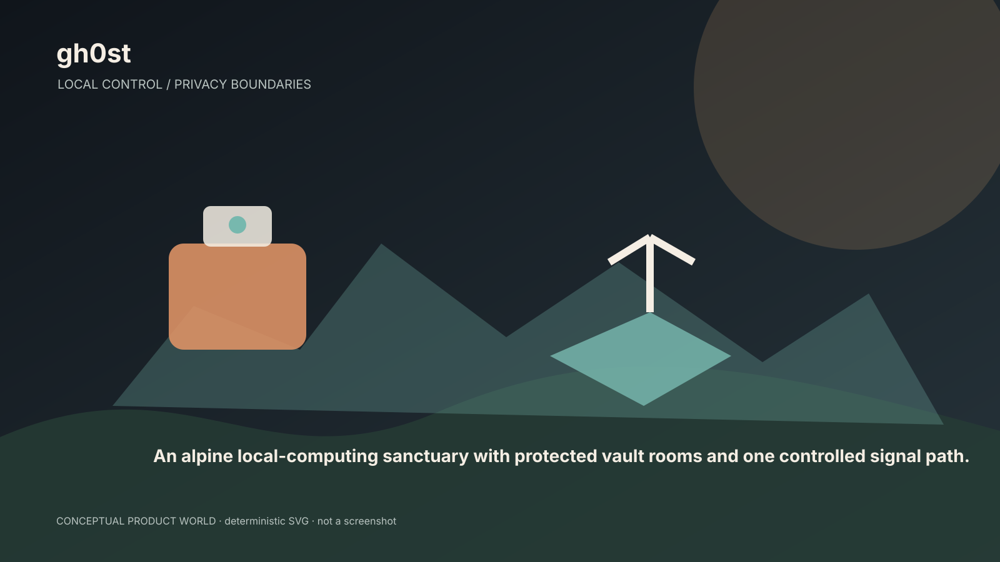
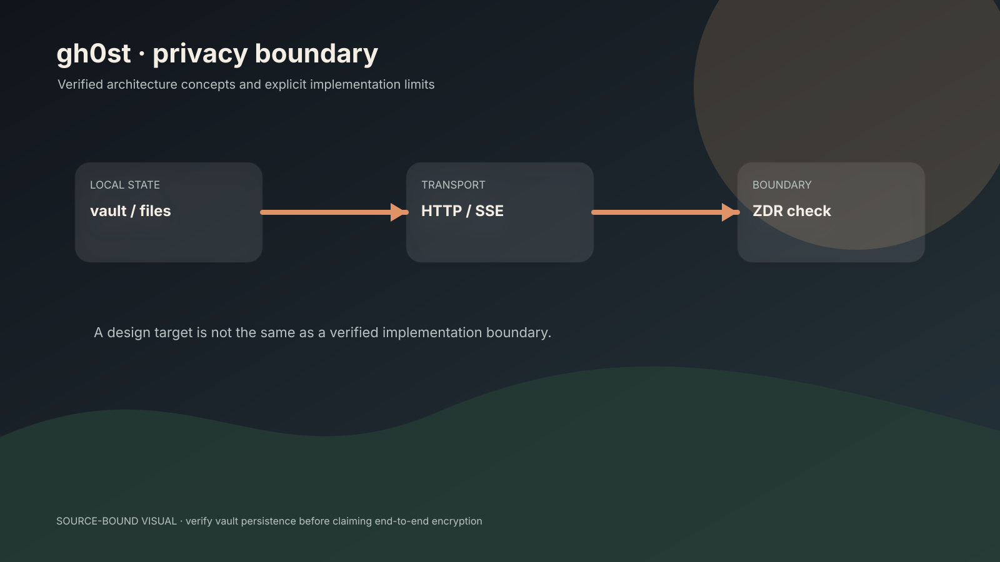
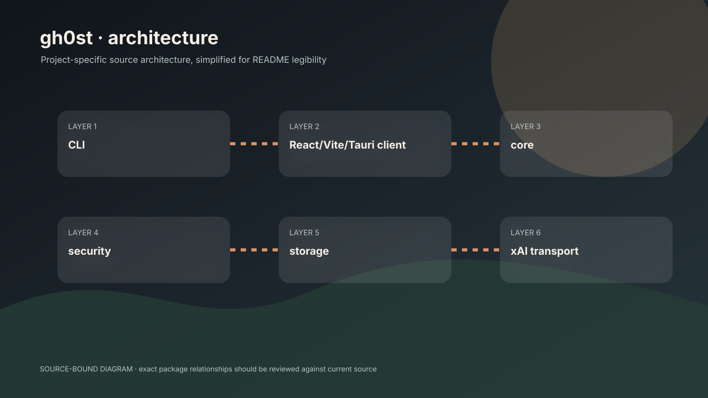

# gh0st

> A local-first xAI/Grok client where privacy boundaries are part of the product surface.

A local-first xAI/Grok client with CLI and React/Tauri surfaces, encrypted vault primitives, local storage, file processing, and explicit ZDR checks.

[Project site](https://gh0st-six.vercel.app) · [NOAERTH](https://www.noaerth.com)



## Why gh0st exists

Most AI clients make the network boundary invisible. gh0st makes the local control surface visible: conversations, files, storage, transport, and Zero Data Retention checks are separate concerns that can be inspected.

## The client experience

The CLI exposes chat, ask, web, status, ZDR, agents, chats, export, import, lock, wipe, and doctor command surfaces. The React/Tauri client adds chat UI, model selection, privacy indicators, attachments, tool toggles, and an agent selector. The xAI package includes HTTP/WebSocket transport code and SSE streaming.



## Architecture and data boundaries

`apps/cli` and the React/Tauri client sit on shared core, security, storage, xAI transport, file-processing, and UI packages. The intended security primitives include AES-256-GCM and HKDF purpose-derived keys.



Important implementation boundaries remain visible: Tauri vault commands contain stubs; browser state uses ordinary `localStorage`; file storage writes ordinary JSON; and tool-call/retry/edit paths are incomplete. This README does not turn those gaps into security guarantees.

## Quick start

```bash
`./setup.sh`
`pnpm install`
`pnpm build`
`./apps/cli/dist/cli.js doctor`
`./apps/cli/dist/cli.js chat`
```

The commands are documented source commands. A live xAI API-key run and current ZDR behavior still need independent verification.

## Evidence snapshot

| Evidence | Interpretation |
|---|---|
| 12 CLI command surfaces | Source-backed; see `v4/VERIFIED_METRICS.json` for definition and status. |
| 1 committed security test file (not executed here) | Source-backed; see `v4/VERIFIED_METRICS.json` for definition and status. |
| AES-256-GCM/HKDF primitives | Source-backed; see `v4/VERIFIED_METRICS.json` for definition and status. |

## Source map

- `apps/cli/src/cli.ts`
- `packages/security/src/web-crypto.ts`
- `packages/xai/src/http-transport.ts`
- `packages/storage/src/file-storage/file-storage.ts`

## Status

Research-stage / active development. The strongest current story is the privacy architecture and local client surface, not production security certification.

## Roadmap boundary

Future work should close the storage-encryption integration gap, finish native vault behavior, resolve attachment persistence, and complete tool/retry/edit flows before stronger end-to-end privacy claims are made.
